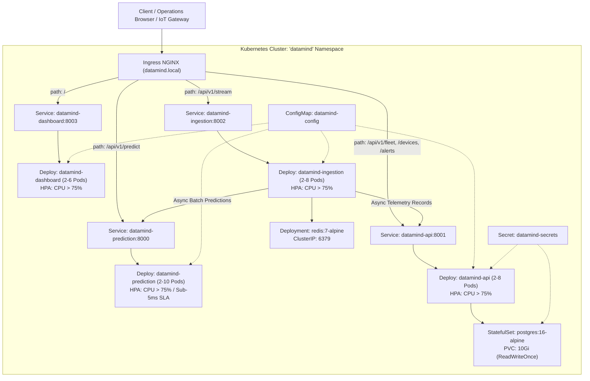
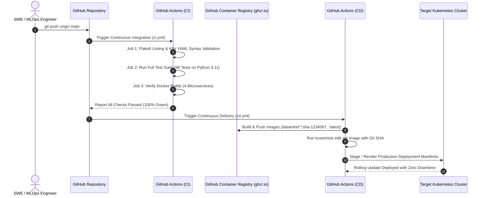

# Milestone 14: Kubernetes Architecture & GitHub Actions CI/CD Pipelines

> **Milestone ID:** `M14-KUBERNETES-CICD`  
> **Status:** Completed  
> **Date:** 2026-10-11  
> **Framework:** Kubernetes 1.28+, Kustomize v5, Ingress NGINX, HorizontalPodAutoscaler, GitHub Actions  
> **Manifests Directory:** [`infrastructure/k8s/`](../../infrastructure/k8s/)  
> **Workflows Directory:** [`.github/workflows/`](../../.github/workflows/)  
> **Test Coverage:** 8 Automated Tests in [`tests/infrastructure/test_k8s_and_cicd.py`](../../tests/infrastructure/test_k8s_and_cicd.py) (98 Total Passing Tests in Repo)  

---

## 1. Objective & Motivation

Moving an enterprise-grade predictive intelligence system from local orchestration into cloud-native production requires robust container orchestration, self-healing guarantees, horizontal autoscaling, traffic routing, and an automated continuous delivery lifecycle.

Milestone 14 establishes the **DataMind Kubernetes & CI/CD Production Infrastructure**:
1. **Cloud-Native Kubernetes Architecture (`infrastructure/k8s/`):**
   - Declarative `datamind` namespace isolation with Kubernetes recommended labels (`app.kubernetes.io/*`).
   - Centralized `ConfigMap` and base64-encoded `Secret` resources decoupling configuration from container code.
   - Stateful persistence via `PostgreSQL` StatefulSet with persistent volume claims (`10Gi`, `ReadWriteOnce`) and automated `pg_isready` health checks.
   - High-throughput caching layer with `Redis` Deployment and ClusterIP service.
   - High-availability stateless microservice Deployments (`datamind-prediction`, `datamind-api`, `datamind-ingestion`, `datamind-dashboard`) configured with zero-downtime `RollingUpdate` deployment strategies (`maxSurge: 1`, `maxUnavailable: 0`), explicit resource boundaries (CPU/Memory requests & limits), and HTTP `/health` liveness/readiness probes.
   - Dynamic auto-scaling via `HorizontalPodAutoscaler` (HPA) scaling pods between 2 and 10 replicas under burst load.
   - Unified reverse-proxy ingress gateway (`ingress.yaml`) routing external internet traffic across all microservices based on URI prefixes.
   - Single-command GitOps packaging via `Kustomize` (`kustomization.yaml`) enabling `kubectl apply -k infrastructure/k8s/`.
2. **Automated Continuous Integration (CI) Pipeline (`.github/workflows/ci.yml`):**
   - Automated triggers on all `push` and `pull_request` events to `main`.
   - Automated syntax linting and PEP8 compliance checks via `flake8`.
   - Comprehensive multi-document YAML syntax validation across all Kubernetes manifests.
   - Full automated test suite execution (98 tests across data pipelines, ML models, microservices, and infrastructure) on Python 3.11 with zero allowable failures.
   - Multi-container Docker build dry-runs verifying container image buildability across all 4 microservices.
3. **Automated Continuous Delivery (CD) Pipeline (`.github/workflows/cd.yml`):**
   - Multi-stage container builds and push to GitHub Container Registry (`ghcr.io/faizalkhan24/datamind-*`).
   - Semantic versioning, short Git SHA digests, and automated tag generation.
   - Automated GitOps deployment staging via `kustomize edit set image` and manifest dry-run synthesis.

---

## 2. Kubernetes Cluster Architecture & Traffic Flow



---

## 3. Kubernetes Resource Specifications

| Resource Name | Kind | Replicas | CPU (Req / Lim) | Mem (Req / Lim) | Health Check Probe | Target Port |
| :--- | :---: | :---: | :---: | :---: | :---: | :---: |
| `postgres` | `StatefulSet` | 1 | 250m / 1000m | 512Mi / 2Gi | `pg_isready -U datamind_admin` | 5432 |
| `redis` | `Deployment` | 1 | 100m / 500m | 128Mi / 512Mi | `redis-cli ping` | 6379 |
| `datamind-prediction` | `Deployment` | 2–10 (HPA) | 250m / 1000m | 512Mi / 1.5Gi | `GET /health` (port 8000) | 8000 |
| `datamind-api` | `Deployment` | 2–8 (HPA) | 200m / 800m | 256Mi / 1Gi | `GET /health` (port 8001) | 8001 |
| `datamind-ingestion` | `Deployment` | 2–8 (HPA) | 200m / 800m | 256Mi / 1Gi | `GET /health` (port 8002) | 8002 |
| `datamind-dashboard` | `Deployment` | 2–6 (HPA) | 150m / 600m | 256Mi / 512Mi | `GET /health` (port 8003) | 8003 |
| `datamind-ingress` | `Ingress` | — | — | — | NGINX Routing Proxy | 80 / 443 |

---

## 4. Ingress Path Routing Matrix

The ingress gateway (`infrastructure/k8s/ingress.yaml`) terminates edge traffic for domain `datamind.local` and distributes requests according to the path prefix hierarchy:

| Ingress Path Prefix | Destination Service | Destination Port | Protocol | Purpose |
| :--- | :--- | :---: | :---: | :--- |
| `/` | `datamind-dashboard` | 8003 | HTTP | Fleet health operations console & static web UI |
| `/api/v1/predict` | `datamind-prediction` | 8000 | HTTP | Real-time ML inference & SHAP explainability (<5ms SLA) |
| `/api/v1/fleet` | `datamind-api` | 8001 | HTTP | Fleet overview statistics & health aggregations |
| `/api/v1/devices` | `datamind-api` | 8001 | HTTP | Hardware device registration & metadata query |
| `/api/v1/alerts` | `datamind-api` | 8001 | HTTP | Operational alert lifecycle & status updates |
| `/api/v1/stream` | `datamind-ingestion` | 8002 | HTTP | High-throughput telemetry ingestion & window buffers |

---

## 5. GitHub Actions CI/CD Automation Lifecycle



---

## 6. Automated Infrastructure Test Suite

Milestone 14 provides 8 automated tests in [`tests/infrastructure/test_k8s_and_cicd.py`](../../tests/infrastructure/test_k8s_and_cicd.py):

```python
# Test execution command
python -m unittest tests/infrastructure/test_k8s_and_cicd.py -v
```

### Verified Test Cases:
1. `test_k8s_manifests_exist_and_parse_valid_yaml`: Asserts all 11 Kubernetes YAML manifests exist, are well-formed, and parse cleanly via `yaml.safe_load_all`.
2. `test_k8s_labels_standardization`: Asserts that all microservice manifests adhere strictly to Kubernetes recommended label standards (`app.kubernetes.io/name`, `app.kubernetes.io/part-of: datamind`).
3. `test_k8s_microservices_resource_limits_and_probes`: Asserts that `datamind-prediction`, `datamind-api`, `datamind-ingestion`, and `datamind-dashboard` declare HTTP `/health` readiness and liveness probes, valid CPU/memory requests and limits, and zero-downtime `RollingUpdate` strategies.
4. `test_k8s_horizontal_pod_autoscalers`: Validates HPA definitions (`minReplicas >= 2`, `maxReplicas >= 6`, target CPU utilization triggers).
5. `test_k8s_ingress_routing_rules`: Validates Ingress prefix routing paths and binds each route to the matching cluster service.
6. `test_k8s_kustomization_bundle`: Asserts that `kustomization.yaml` declares namespace `datamind`, indexes all 10 manifests, and configures all 4 container images.
7. `test_github_actions_ci_workflow`: Asserts that `.github/workflows/ci.yml` declares `push` and `pull_request` triggers on `main`, matrix on Python 3.11, and runs `python -m unittest discover -s tests -t .`.
8. `test_github_actions_cd_workflow`: Asserts that `.github/workflows/cd.yml` defines image build matrices for all 4 microservices and stages deployment via Kustomize.

---

## 7. Operational Runbook

### 7.1 Single-Command Cluster Deployment
```bash
# 1. Apply full manifest bundle via Kustomize
kubectl apply -k infrastructure/k8s/

# 2. Verify all pods reach Running state
kubectl get pods -n datamind -w

# 3. Verify horizontal pod autoscalers
kubectl get hpa -n datamind

# 4. Verify ingress endpoints
kubectl get ingress -n datamind
```

### 7.2 Zero-Downtime Rolling Updates & Rollback
```bash
# Deploy a new image tag
kubectl set image deployment/datamind-prediction prediction=ghcr.io/faizalkhan24/datamind-prediction:v1.1.0 -n datamind

# Monitor rolling update rollout status
kubectl rollout status deployment/datamind-prediction -n datamind

# Instant rollback if anomalous metrics are detected
kubectl rollout undo deployment/datamind-prediction -n datamind
```

### 7.3 Local Cluster Testing with Minikube / Kind
```bash
# Enable Ingress and Metrics Server on Minikube
minikube addons enable ingress
minikube addons enable metrics-server

# Deploy DataMind
kubectl apply -k infrastructure/k8s/

# Add local DNS entry
echo "$(minikube ip) datamind.local" | sudo tee -a /etc/hosts

# Open dashboard in browser
curl -I http://datamind.local/
```
